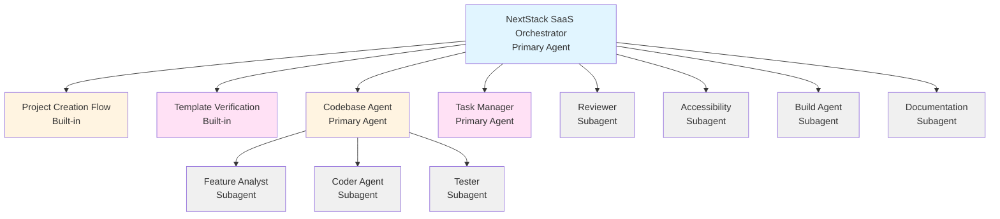
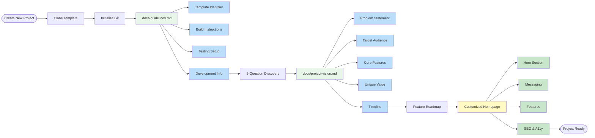
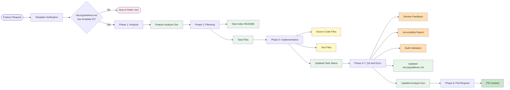
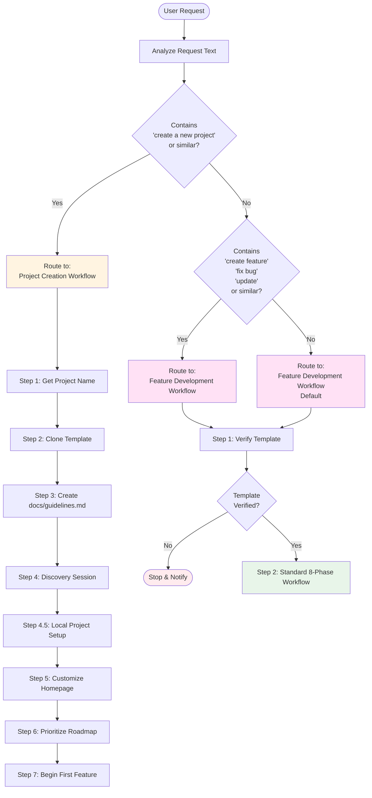

# NextStack SaaS Orchestrator - Workflow Diagram

## Complete NextStack SaaS Flow

```mermaid
flowchart TD
    Start([User Request]) --> Orchestrator[NextStack SaaS Orchestrator]
    
    Orchestrator --> RequestType{Request Type?}
    
    RequestType -->|Create New Project| ProjectFlow[Project Creation Workflow]
    RequestType -->|Feature/Bug/Enhancement| FeatureFlow[Feature Development Workflow]
    
    %% PROJECT CREATION WORKFLOW
    ProjectFlow --> AskName["Ask User:<br/>What should the project be called?"]
    AskName --> GetName[Wait for Project Name]
    GetName --> Clone["Clone Template<br/>git clone nextstack-saas-starter"]
    Clone --> InitGit["Initialize Fresh Repo<br/>rm -rf .git && git init"]
    
    InitGit --> CreateGuidelines["Create docs/guidelines.md<br/>template: nextstack-saas-starter"]
    CreateGuidelines --> BuildDocs["Document Build Instructions<br/>Testing Setup<br/>Development Info"]
    BuildDocs --> VerifyTest["Create & Verify Working Test<br/>Before Documenting"]
    
    VerifyTest --> Discovery["5-Question Discovery Session"]
    
    Discovery --> SaveVision["Save Responses to<br/>docs/project-vision.md<br/>with Feature Roadmap"]
    
    SaveVision --> LocalSetup["Local Project Setup<br/>Follow SETUP_GUIDE.md"]
    LocalSetup --> InstallDeps["Install Dependencies<br/>npm/pnpm/yarn install"]
    InstallDeps --> NotifyClerkKeys["Notify User:<br/>Add Clerk Keys to .env.local<br/>dashboard.clerk.com"]
    NotifyClerkKeys --> WaitConfirm["Wait for User Confirmation<br/>Keys Added"]
    WaitConfirm --> StartDev["Start Dev Server<br/>npm run dev"]
    
    StartDev --> CustomizeHome["Customize Homepage"]
    CustomizeHome --> HomeBranding["Update Hero Section<br/>Problem/Solution Messaging<br/>Feature Highlights"]
    HomeBranding --> HomeQuality["Maintain Modern UI<br/>Add Animations<br/>SEO Optimization<br/>Accessibility Compliance"]
    
    HomeQuality --> ReviewRoadmap["Present Feature Roadmap<br/>High/Medium/Low Priority"]
    ReviewRoadmap --> UserApproval{User Approves<br/>Priority Order?}
    
    UserApproval -->|Adjust| ReviewRoadmap
    UserApproval -->|Approve| StartFeature["Begin Orchestrated Workflow<br/>for First Priority Feature"]
    
    StartFeature --> StandardWorkflow[Standard 8-Phase Workflow]
    
    %% FEATURE DEVELOPMENT WORKFLOW
    FeatureFlow --> VerifyTemplate["Check docs/guidelines.md<br/>for template identifier"]
    VerifyTemplate --> TemplateCheck{Contains<br/>template: nextstack-saas-starter?}
    
    TemplateCheck -->|No| NotifyUser["⚠️ Notify User:<br/>This only works with NextStack template<br/>Use workflow-orchestrator instead"]
    TemplateCheck -->|Yes| TemplateVerified["✅ Template Verified<br/>Continue with workflow"]
    
    NotifyUser --> Stop([Stop - User Must Switch Agents])
    
    TemplateVerified --> BranchCheck{On main/master<br/>branch?}
    
    BranchCheck -->|Yes| CreateBranch["Create Feature Branch<br/>feature/\{feature-name\}"]
    BranchCheck -->|No| Phase1
    CreateBranch --> Phase1[Phase 1: Analysis]
    
    Phase1 --> CodebaseAnalysis[Codebase Agent<br/>Analysis Mode]
    CodebaseAnalysis --> FeatureAnalyst[Feature Analyst Subagent]
    FeatureAnalyst --> AnalysisDoc["Create Analysis Doc<br/>\{feature\}/docs/feature-analysis.md"]
    
    AnalysisDoc --> Phase2[Phase 2: Planning]
    Phase2 --> TaskManager[Task Manager]
    TaskManager --> TaskPlan["Create Task Plan<br/>\{feature\}/tasks/"]
    TaskPlan --> Approval{User Approval?}
    
    Approval -->|No| TaskManager
    Approval -->|Yes| Phase3[Phase 3: Implementation]
    
    Phase3 --> CodebaseImpl[Codebase Agent<br/>Implementation Mode]
    
    CodebaseImpl --> SubtaskLoop{More Subtasks?}
    
    SubtaskLoop -->|Yes| MarkStarted["Codebase Agent:<br/>Mark TODO → IN-PROGRESS"]
    MarkStarted --> ReadSubtask["Codebase Agent:<br/>Read Subtask File"]
    ReadSubtask --> CoderAgent["Coder Agent Subagent:<br/>Implement Code<br/>Mark Acceptance Criteria"]
    CoderAgent --> TesterAgent["Tester Subagent:<br/>Write & Run Tests<br/>Mark Test Checklists"]
    TesterAgent --> Validate["Codebase Agent:<br/>Validate Type Check, Lint, Tests"]
    Validate --> VerifyUpdates["Codebase Agent:<br/>Verify Subtask File Updated"]
    VerifyUpdates --> UpdateStatus["Codebase Agent:<br/>Mark IN-PROGRESS → COMPLETE"]
    UpdateStatus --> SubtaskLoop
    
    SubtaskLoop -->|No| FinalValidation[Final Validation<br/>Full Test Suite<br/>Dev Environment Check]
    FinalValidation --> Phase4[Phase 4: Quality Assurance]
    
    Phase4 --> ReviewerAgent[Reviewer Subagent<br/>Code Review<br/>Security & Acceptance Criteria]
    ReviewerAgent --> Phase5[Phase 5: Accessibility Audit]
    
    Phase5 --> WebCheck{Web Files<br/>Changed?}
    WebCheck -->|Yes| AccessibilityAgent[Accessibility Subagent<br/>WCAG Audit<br/>Semantic HTML & ARIA]
    WebCheck -->|No| Phase6[Phase 6: Build Validation]
    AccessibilityAgent --> Phase6
    
    Phase6 --> BuildAgent[Build Agent Subagent<br/>Build & Environment Check<br/>NextStack Template Validation]
    BuildAgent --> Phase7[Phase 7: Documentation]
    
    Phase7 --> DocsAgent[Documentation Subagent<br/>Update docs/guidelines.md<br/>Update Feature Docs]
    DocsAgent --> UpdatePatterns["Update Analysis Doc<br/>\{feature\}/docs/feature-analysis.md"]
    UpdatePatterns --> Phase8[Phase 8: Pull Request]
    
    Phase8 --> PRCheck{On feature<br/>branch?}
    
    PRCheck -->|Yes| CreatePR["Push Branch & Create PR<br/>gh pr create"]
    PRCheck -->|No| SkipPR["Skip PR Creation<br/>On main/master"]
    
    CreatePR --> Complete([Feature Complete])
    SkipPR --> Complete
    StandardWorkflow --> Complete
    
    style Orchestrator fill:#e1f5ff
    style ProjectFlow fill:#fff4e1
    style FeatureFlow fill:#ffe1f5
    style CodebaseAnalysis fill:#fff4e1
    style TaskManager fill:#ffe1f5
    style CodebaseImpl fill:#fff4e1
    style FeatureAnalyst fill:#f0f0f0
    style CoderAgent fill:#f0f0f0
    style TesterAgent fill:#f0f0f0
    style ReviewerAgent fill:#f0f0f0
    style BuildAgent fill:#f0f0f0
    style DocsAgent fill:#f0f0f0
    style AccessibilityAgent fill:#f0f0f0
    style AnalysisDoc fill:#e8f5e9
    style TaskPlan fill:#e8f5e9
    style UpdatePatterns fill:#e8f5e9
    style CreateGuidelines fill:#e8f5e9
    style SaveVision fill:#e8f5e9
    style NotifyUser fill:#ffebee
    style TemplateVerified fill:#e8f5e9
```



## Agent Hierarchy for NextStack SaaS



## Project Creation Artifacts



## Feature Development Artifacts (After Template Verification)



## Decision Flow: Request Type Routing



## Phase Details for NextStack SaaS

### Project Creation Workflow

#### Step 1: Get Project Name
- **Purpose:** Obtain clear project name from user
- **Interaction:** Ask explicit question and wait for response
- **Output:** Project name used throughout setup

#### Step 2: Clone Template Repository
- **Command:** `git clone https://github.com/jesusidev/nextstack-saas-starter {project-name}`
- **Purpose:** Create new project from NextStack SaaS Starter template
- **Post-Clone:** Remove existing git history and initialize fresh repo
- **Output:** New project directory with template code

#### Step 3: Initialize Project Documentation
- **File:** `docs/guidelines.md`
- **Critical Requirement:** Must start with `template: nextstack-saas-starter` in YAML frontmatter
- **Sections:**
  1. **Build/Configuration Instructions** - Project-specific only, no generic content
  2. **Testing Information** - Setup, running tests, adding tests, verified working example
  3. **Additional Development Information** - Code style, architecture, debugging, resources
- **Audience:** Advanced developers and AI agents
- **Verification:** Create and run a working test before documenting it

#### Step 4: Onboarding Discovery Session
- **Format:** 5 questions, one at a time
- **Interaction Pattern:**
  - Ask question
  - Wait for user response
  - Provide encouraging, relevant feedback
  - Move to next question
- **Questions:**
  1. What problem does the project solve?
  2. Who is the target audience?
  3. What are the top 3 features to build first?
  4. What makes the project different?
  5. What is the timeline and launch priority?
- **Output:** `docs/project-vision.md` with responses and feature roadmap

#### Step 4.5: Local Project Setup
- **Purpose:** Set up the project locally following SETUP_GUIDE.md Quick Start
- **Prerequisites:** Template cloned, documentation created, discovery session completed
- **Workflow:**
  1. **Install Dependencies**
     - Run package manager install command
     - Commands: `npm install` or `pnpm install` or `yarn install`
     - Wait for installation to complete
  2. **Configure Environment Variables**
     - Notify user to set up Clerk authentication keys
     - Provide link: https://dashboard.clerk.com
     - Instruct user to create `.env.local` file with required keys:
       - `NEXT_PUBLIC_CLERK_PUBLISHABLE_KEY` (starts with `pk_test_` or `pk_live_`)
       - `CLERK_SECRET_KEY` (starts with `sk_test_` or `sk_live_`)
     - Wait for user confirmation that keys are added
     - **Important:** User adds keys manually, not provided to agent
  3. **Start Development Server**
     - Run dev server command
     - Commands: `npm run dev` or `pnpm dev` or `yarn dev`
     - Verify server starts successfully at http://localhost:3000
- **Mandatory Environment Variable:** Clerk authentication keys only
- **Optional Variables:** Can be configured later as needed
- **Security:** User adds keys directly to `.env.local` file (not shared with agent)
- **Output:** 
  - Dependencies installed
  - `.env.local` file created by user with Clerk keys
  - Development server running locally
  - Project accessible at http://localhost:3000
- **Next Step:** Homepage customization with live preview

#### Step 5: Customize Homepage
- **Purpose:** Brand the landing page with project identity
- **Requirements:**
  - Use project name throughout
  - Incorporate messaging from project-vision.md
  - Maintain modern, beautiful UI (no quality degradation)
  - Add meaningful animations
  - Strong SEO foundation (meta tags, semantic HTML)
  - Full accessibility compliance (WCAG 2.1 AA minimum)
  - Preserve existing design system
- **Elements to Customize:**
  - Hero section (headline, subheadline, CTA)
  - Problem/solution messaging
  - Feature highlights
  - Social proof / trust indicators
  - Footer branding

#### Step 6: Prioritize Roadmap Tasks
- **Purpose:** Get user approval on feature priorities
- **Interaction:**
  - Present roadmap with High/Medium/Low priority features
  - Ask for approval or adjustments
  - Wait for confirmation
- **Options:**
  1. Approve priority order
  2. Adjust priorities
  3. Add more features
  4. Start with specific feature
- **Next Step:** Begin orchestrated workflow for first approved feature

#### Step 7: Begin First Feature
- **Trigger:** User approves roadmap
- **Action:** Start standard 8-phase workflow for highest priority feature
- **Confirmation:** Ask user before proceeding

---

### Feature Development Workflow (Template Verification Required)

#### Step 1: Verify Template Usage
- **Critical Check:** Read `docs/guidelines.md` and verify it contains:
  ```yaml
  ---
  template: nextstack-saas-starter
  ---
  ```
- **If Missing:**
  - Stop workflow immediately
  - Notify user: "This only works with NextStack SaaS Starter template"
  - Direct user to use standard `workflow-orchestrator` agent
  - Provide instructions for switching agents
- **If Present:**
  - Confirm verification
  - Continue to standard workflow

#### Step 2: Standard 8-Phase Workflow

Once template is verified, proceed with identical workflow from `workflow-orchestrator`:

##### Phase 0: Git Branch Check
- **Purpose:** Ensure work happens on feature branches
- **Check:** `git branch --show-current`
- **Action:**
  - If on main/master: Prompt to create feature branch
  - If on feature branch: Continue
- **Safety:** Prevents commits to main/master

##### Phase 1: Analysis & Understanding
- **Agent:** @codebase-agent (analysis mode)
- **Subagent:** @feature-analyst
- **Output:** `{feature}/docs/feature-analysis.md`
- **Purpose:** Understand NextStack template patterns relevant to feature
- **Context:** Loads template-specific patterns from `docs/guidelines.md`

##### Phase 2: Planning
- **Agent:** @task-manager
- **Input:** Pattern analysis + template guidelines
- **Output:** `{feature}/tasks/` with README and subtask files
- **Purpose:** Break down feature into atomic subtasks
- **User Approval:** Wait for task plan approval before proceeding

##### Phase 3: Implementation
- **Agent:** @codebase-agent (implementation mode)
- **Subagents:** @coder-agent, @tester
- **Output:** Code + tests + updated task status
- **Template Context:** Uses NextStack patterns from guidelines
- **Validation:** Type checks, linting, tests per template standards

##### Phase 4: Quality Assurance
- **Subagent:** @reviewer
- **Output:** Code review feedback
- **Checks:** Quality, security, performance, acceptance criteria
- **Template Validation:** Ensures code follows NextStack conventions

##### Phase 5: Accessibility Audit
- **Subagent:** @accessibility
- **Output:** WCAG compliance report
- **Scope:** Web files only (HTML, JSX, TSX, etc.)
- **Standards:** WCAG 2.1 AA minimum (template requirement)
- **Skip:** Automatically skipped if no web files changed

##### Phase 6: Build Validation
- **Subagent:** @build-agent
- **Output:** Build validation + environment check
- **Validates:**
  - Type checking
  - Build compilation
  - NextStack template-specific build commands
  - Dev environment startup
- **Commands:** Uses validation commands from `docs/guidelines.md`

##### Phase 7: Documentation
- **Subagent:** @documentation
- **Output:** Updated documentation
- **Updates:**
  - `docs/guidelines.md` (if needed)
  - README.md (if needed)
  - API documentation (if needed)
  - `{feature}/docs/feature-analysis.md` (pattern updates)
- **Purpose:** Keep template-specific docs current

##### Phase 8: Pull Request Creation
- **Agent:** @workflow-orchestrator
- **Condition:** Only if on feature branch
- **Actions:**
  1. Push branch to remote
  2. Create PR with comprehensive summary
  3. Include links to task documentation
  4. List validation status
- **Skip:** If on main/master, warn user
- **Commands:** `git push -u origin {branch}`, `gh pr create`

---

## Error Handling

### Template Verification Failure
```
❌ Template Verification Failed

Checked: docs/guidelines.md
Missing: template: nextstack-saas-starter

⚠️  This orchestrator only works with NextStack SaaS Starter projects.

Next Steps:
  1. Use standard workflow-orchestrator instead
  2. Switch with: /agent workflow-orchestrator

Would you like instructions for switching agents?
```

### Phase Errors (Same as Standard Workflow)
1. **STOP immediately** - Do not proceed
2. **Report error clearly** with phase, agent, and details
3. **Provide recovery options:**
   - 🔄 Retry
   - 🔧 Debug
   - ⏭️  Skip (not recommended)
   - ❌ Abort
4. **Wait for user decision**
5. **Never continue** with unresolved errors

---

## Context Loading for NextStack SaaS

### Base Context (Always Loaded)
- NextStack SaaS Starter template patterns
- `docs/guidelines.md` - Template-specific guidelines
- `docs/project-vision.md` - Project goals and priorities
- Template repository conventions
- NextStack-specific build and test commands

### Phase-Specific Context
- **Project Creation:**
  - Template repository structure
  - Required documentation format
  - Homepage component structure
  - SEO and accessibility patterns from template
- **Analysis:**
  - NextStack component patterns
  - Template state management approach
  - API conventions from template
- **Planning:**
  - Task templates aligned with NextStack structure
  - Template-specific acceptance criteria
- **Implementation:**
  - NextStack code patterns from guidelines
  - Template testing framework
  - Build and validation commands
- **Review:**
  - Template quality standards
  - NextStack security guidelines
- **Accessibility:**
  - WCAG 2.1 AA/AAA standards
  - Template accessibility patterns
- **Build:**
  - Template build configuration
  - NextStack-specific validation commands
- **Documentation:**
  - Template documentation standards
  - NextStack pattern documentation format

---

## Key Differences from Standard Workflow Orchestrator

| Aspect | Standard Workflow | NextStack SaaS |
|--------|------------------|----------------|
| **Entry Point** | Direct to workflow | Template verification required |
| **Project Creation** | Not included | Full onboarding and setup workflow |
| **Template Check** | Not required | Required before any feature work |
| **Documentation** | Generic guidelines | Template identifier + NextStack specifics |
| **Context Loading** | General patterns | NextStack template patterns + docs/guidelines.md |
| **Homepage Setup** | Not included | Customized with branding, SEO, accessibility |
| **Discovery Session** | Not included | 5-question onboarding with vision doc |
| **Roadmap Planning** | Not included | Priority-based feature roadmap |
| **Stop Condition** | Phase errors only | Template verification failure + phase errors |

---

## Usage Examples

### Example 1: Create New Project
```
User: "create a new project"

Orchestrator:
  1. Asks: "What should the project be called?"
  2. Clones template with project name
  3. Creates docs/guidelines.md with template identifier
  4. Runs 5-question discovery session
  5. Saves to docs/project-vision.md
  6. Sets up project locally (installs deps, configures Clerk keys, starts dev server)
  7. Customizes homepage
  8. Reviews roadmap priorities
  9. Begins first feature workflow
```

### Example 2: Add Feature (Template Project)
```
User: "add user authentication feature"

Orchestrator:
  1. Checks docs/guidelines.md
  2. Finds: template: nextstack-saas-starter ✅
  3. Verifies template usage
  4. Proceeds with standard 8-phase workflow
  5. Uses NextStack patterns from guidelines
```

### Example 3: Add Feature (Non-Template Project)
```
User: "add user authentication feature"

Orchestrator:
  1. Checks docs/guidelines.md
  2. Missing: template: nextstack-saas-starter ❌
  3. Stops workflow
  4. Notifies user to use workflow-orchestrator
  5. Provides switching instructions
```

---

## Success Criteria

### Project Creation Complete When:
- ✅ Template cloned to project directory
- ✅ Git initialized with fresh history
- ✅ `docs/guidelines.md` created with template identifier
- ✅ Build instructions, testing setup, dev info documented
- ✅ Working test example verified and documented
- ✅ Discovery session completed (5 questions answered)
- ✅ `docs/project-vision.md` created with feature roadmap
- ✅ Dependencies installed (npm/pnpm/yarn)
- ✅ User notified to add Clerk keys to `.env.local`
- ✅ User confirmed keys are added
- ✅ Development server running at http://localhost:3000
- ✅ Homepage customized with project branding
- ✅ SEO and accessibility implemented
- ✅ Roadmap priorities approved by user
- ✅ Ready to begin first feature

### Feature Development Complete When:
- ✅ Template verification passed
- ✅ All 8 phases completed successfully
- ✅ Code follows NextStack patterns
- ✅ Tests pass using template framework
- ✅ Build validates with template commands
- ✅ Documentation updated in template format
- ✅ PR created (if on feature branch)
